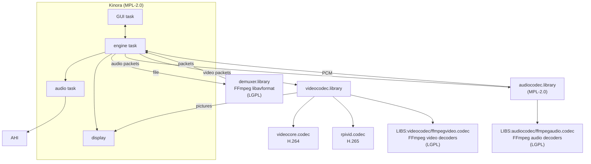
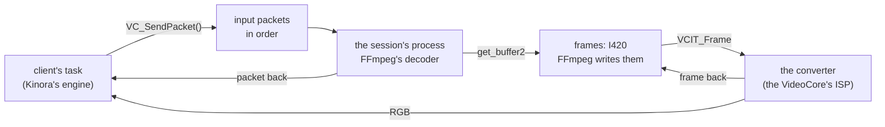

# Kinora: architecture

Kinora is a video player for AmigaOS 3.2 on a PiStorm with a Raspberry Pi 4 or CM4 under Emu68.
It looks and works like Media Player Classic: one window with the picture above a row of simple
playback controls, and everything else in the menus. The Pi decodes the video, through
`videocodec.library`. Kinora adds what that library does not have: reading container files,
decoding sound, keeping sound and picture together, subtitles, and the user interface.

This document says how Kinora is built and why, at the level of its parts, tasks and data
paths; the source files say the rest. What a user sees is in the [README](../README.md).

## 1. What it plays

- **Machines:** the Pi 4 and the CM4, where everything is tested; the Pi 3 with H.264 only,
  untested for want of one. Machines without `videocodec.library` are out of scope for good.
- **Files:** local ones, and those on the network through smb2fs. Matroska and WebM, MP4 and
  QuickTime, MPEG transport and programme streams (VCD and DVD files), AVI.
- **Video:** H.264 and H.265, decoded by the Pi's hardware. What the hardware does not decode
  is refused with a plain message, not shown wrongly: 10-bit H.264, H.264 above 1080p, and
  10-bit H.265 above 1080p. 10-bit H.265 up to 1080p plays, without tone mapping, so HDR
  material looks washed out. MPEG-1, MPEG-2, MPEG-4 Part 2 (Xvid, DivX), MS-MPEG4 (DivX 3),
  H.263 and Theora are decoded by FFmpeg on the 68k (section 14), up to 1920×1088; standard
  definition keeps up, larger pictures as far as the CPU allows. Interlaced pictures are
  shown as they are, combed.
- **Sound:** AAC (LC, HE, HE v2, also LATM), AC-3, E-AC-3, DTS, MP3, MP2, Opus, Vorbis, FLAC,
  TrueHD, PCM, a DVD's LPCM, IMA and Microsoft ADPCM, A-law and µ-law, decoded by FFmpeg on the
  68k and played through AHI in stereo or 7.1.
- **Subtitles:** text, from the film's streams (SubRip, ASS events, MP4 timed text) or from a
  SubRip file.
- **YouTube** is out of scope for good: its pages and signatures change too often to follow.

## 2. Parts



| Binary | Job | Licence |
|---|---|---|
| `Kinora` | Engine, GUI, subtitle parsing and drawing | MPL-2.0 |
| `LIBS:demuxer.library` | Reads container files; our API over FFmpeg's libavformat | LGPL-2.1-or-later |
| `LIBS:audiocodec.library` | Audio decode sessions; finds backends in a drawer | MPL-2.0 |
| `LIBS:audiocodec/ffmpegaudio.codec` | The audio decoders of FFmpeg's libavcodec | LGPL-2.1-or-later |
| `LIBS:videocodec/ffmpegvideo.codec` | The video decoders of FFmpeg's libavcodec, a backend of `videocodec.library` | LGPL-2.1-or-later |

**One `ffmpegaudio.codec`, not one per codec.** A backend lists a row per codec, so a program
already picks codecs one by one. Splitting the binary would buy nothing in licence (all rows
are LGPL) and would cost size: the decoders share most of what they are made of (bit readers,
the transforms, the float routines, libavutil, the C library), 360 KB or more that every
per-codec binary would carry again, eleven times over. A second, different decoder for one
codec would come as its own backend beside this one; nothing in the API changes.

Rules that hold the parts apart:

- The demuxer, the audio decoders and the video decoders never share a binary. Each of the
  three FFmpeg binaries is built from the same pinned source with its own configuration.
- No FFmpeg type, constant or structure appears in a public header. An FFmpeg update changes
  nothing for a caller.
- The demuxer hands out packets; it decodes nothing. The player passes video packets to
  `videocodec.library` and audio packets to `audiocodec.library`.
- Subtitle packets are parsed and drawn by the player.
- FFmpeg is configured without its GPL and non-free parts. Its source, our patches and the
  build script are published with each release, which together with the separate, replaceable
  binaries meets the LGPL.

What the switches we leave off would add, from FFmpeg 9.0.2's `configure`. Kinora uses none of
it, so nothing is given up.

`--enable-gpl` (the result becomes GPL):

| Part | What it is |
|---|---|
| x264, x265, Xvid | H.264, H.265 and MPEG-4 encoders |
| xavs, xavs2, davs2 | Encoders and a decoder for the Chinese AVS video standards |
| libcdio | Reads audio CDs |
| libdvdnav, libdvdread | Read and navigate DVDs |
| vid.stab | Video stabilisation filter |
| Rubber Band | Audio time-stretch and pitch filter |
| frei0r | Video effect plug-ins |
| AviSynth | Reads AviSynth scripts as input |
| 32 video filters | Denoisers, deinterlacers, logo removal, `eq`, `stereo3d` and the like |

`--enable-nonfree` (the result may not be redistributed):

| Part | What it is |
|---|---|
| FDK AAC | Fraunhofer's AAC encoder and decoder |
| libmpeghdec | MPEG-H 3D audio decoder |
| DeckLink | Blackmagic capture and playback cards |
| CUDA | Filters on Nvidia graphics cards |

`--enable-version3` (the licence becomes LGPL 3):

| Part | What it is |
|---|---|
| OpenCORE AMR, VisualOn AMR-WB | AMR speech codecs |
| GMP | Big-number maths, for RTMP encryption |
| mbedTLS | TLS for network streams |
| libaribb24 | Japanese broadcast captions |
| lensfun | Lens-correction filter |
| Rockchip MPP | Hardware codecs of Rockchip boards |

We build no filters and link no external library. FFmpeg's own AAC decoder, the one we use, is
LGPL; FDK AAC is only an alternative to it.

## 3. FFmpeg on the Amiga

FFmpeg 9.0.2 is a pinned submodule, never modified. The build copies it, applies our patches to
the copy, and builds each configuration with FFmpeg's own configure and make inside the shared
build container.

What the build needs:

- `--host-cc=m68k-amigaos-gcc`: FFmpeg's configure insists on a host compiler, but with these
  options the build never runs one, so naming the cross compiler satisfies it;
- `--disable-everything`, no threads, no assembly (`--disable-asm --disable-inline-asm`), no
  network, `--target-os=none`;
- three patches: static alignment capped at 4 bytes, which is all Amiga hunk objects give; an
  option of the AC-3 and E-AC-3 decoders, `normalize_downmix` (on by default, as upstream), that
  leaves a mix down at its sources' levels (section 5); and IDCTs laid out for Emu68
  (`libavcodec/m68k/`, section 14);
- gcc's incompatible-pointer error turned back into a warning (`int32_t` is `long` here);
- prototypes for `mkstemp` and `usleep`, and our own three `__atomic_*_4` helpers.

What shapes the libraries:

- **One task at a time.** A thread-less FFmpeg must not be entered by two tasks at once. Each
  FFmpeg binary takes one semaphore around every call into FFmpeg, and the atomic helpers run
  under `Forbid()`.
- **FFmpeg inside a shared library.** libnix's library start-up gives the resident tag and the
  standard vectors, nothing else. What a program's start-up code would do, the library does
  itself: it defines `SysBase` and the heads of libnix's init, exit and library lists, opens
  the libraries on that list (dos, locale, utility, mathieeedoubtrans), runs the init functions
  by priority when it is loaded and the exit functions when it is expunged, and supplies
  `exit()` and `abort()`, which return to the library's entry and fail the call.
- **libnix stays.** FFmpeg calls about a hundred C library functions: some thirty of maths, the
  string and memory ones, `snprintf`/`vsnprintf`/`sscanf`, the `strto*` family, `qsort`, time
  conversion, `malloc`, and a little stdio and POSIX file I/O through its logging and file
  helpers. Replacing only the four parts of libnix that need start-up code (`malloc`, stdio,
  the file calls, `clock()`) would be a day or two of work, a whole C library of our own one
  to two weeks and again in part at every FFmpeg update, for no saving in size: libnix and its
  maths are 50 KB of each binary.
- **But not libnix's memory copies.** Its `memcpy()` calls Exec's `CopyMem()` through the
  library vector for every copy. Every library that carries FFmpeg links emu68-common's
  `memcpy`, `memmove` and `memset` instead, as objects ahead of every library: made for the
  Emu68 JIT (longword loops for short copies, 64-byte `movem.l` blocks for long ones, branches
  that keep a translated block whole) and measured there.
- **Emu68's multiply.** Emu68 before upstream commit `7384501` computes a 32-bit multiply
  followed by a register-count shift wrongly, which stops five of the audio decoders from
  opening. The README names the build needed; the libraries do not test for the fault.
- **The demuxers know less without decoders.** FFmpeg warns "unspecified frame size" for MP3
  in Matroska, for one. What the player needs was there in every file tried, and the audio
  decoder's first frame is the authority on the format in any case.

How it is compiled, for Emu68. Emu68 translates the 68k code into ARM code in units, and a
unit is translated along the path it predicts at each conditional branch: a short backward
branch taken, every other branch not taken. The other path leaves the unit, and leaving costs
far more than the instructions do. So what costs is the number of 68k instructions and of
taken forward branches, not cycles, and the hot path must be the one that falls through.

- **-O3**, not `--enable-small`: 15 to 25 % faster on video, a little on sound.
- **Misaligned reads** (`-mno-strict-align`, and `HAVE_FAST_UNALIGNED` and `HAVE_FAST_CLZ` set
  in FFmpeg's `config.h` after configure, which sets neither for m68k): gcc's m68k backend
  assumes strict alignment, and every bitstream refill and motion-compensation read was put
  together a byte at a time. 6 to 17 % on video.
- **Branchless clamps** (`ffmpeg/branchless_clip.h`, forced in ahead of every FFmpeg file;
  `libavutil/common.h` defines its own only where these are absent, so FFmpeg's source is
  untouched): FFmpeg's `av_clip_uint8()` and its kind compile to "compare, branch forward when
  in range", which left the unit once a pixel. 12 % on MPEG-4, 21 % on MPEG-2.
- **Profile-guided layout.** gcc lays each branch out by counts measured on the Amiga, so the
  common path falls through: another 15 to 28 % on video, 8 to 15 % on sound, 17 to 25 % on
  the demuxer, and a smaller binary. How the profiles are made follows.

Profile-guided builds. A build knob, `KINORA_PGO`, takes `OFF`, `GENERATE` or `USE` (the
default):

- `GENERATE` builds FFmpeg in each of the three binaries with `-fprofile-arcs`. libgcov's own
  writer finds no file under libnix and says nothing, so each library keeps the records itself
  (`ffmpeg/pgo_dump.c`: its own `__gcov_init()`, `__gcov_info_to_gcda()` for the writing, and a
  stub `__gcov_read_counter()` that keeps libgcov's file code out of the link) and writes them
  as one stream through a private call after its public ones, which the `PgoDump` tool makes
  from the training rig's process: never in an expunge, under `Forbid()`. The profiling code
  registers itself through constructors, which a library runs only with libnix's constructor
  lists in it and libnix's runner linked (`-u ___initcpp`); only a program's start-up brings
  them otherwise.
- **The training round** runs on the hardware: the instrumented binaries in their places, the
  rigs (`FilmInfo` reading every packet, decoding the sound, decoding the video) over training
  material made from parts of Tears of Steel (CC-BY) that the tests never use, and `PgoDump`
  for each binary. The host merges the streams (`gcov-tool merge-stream`) into `.gcda` files,
  kept in the repository under `profiles/<configuration>/`, with a stamp of what they were made
  from: the FFmpeg commit, the patches, the flags.
- `USE` copies them beside the objects and compiles with `-fbranch-probabilities`. A profile
  belongs to one FFmpeg source and set of flags: gcc checks each function's file, line and
  shape against it and stops the build at a mismatch, and the build stops before that when
  the stamp differs. Moving FFmpeg, changing a patch or a flag means training again, a
  hardware round, or building with `OFF` meanwhile. Code no training reached is laid out as
  cold (Theora untrained: 10 % slower than without a profile), so every codec and container
  offered is in the training.
- The instrumented and the profile-guided builds compile the same files at the same paths,
  line for line, so the generate build's extras (the private call, the writer) are in files of
  their own and in a macro within a line, never an extra line of a file both compile.

Sizes and costs, measured on the CM4:

| What | Measured |
|---|---|
| `demuxer.library` | 1.36 MB with AVI and programme streams (868 KB as `--enable-small` built it, before them; 1.76 MB at -O3 without a profile) |
| `ffmpegaudio.codec` | 1.53 MB with ADPCM, A-law, µ-law and LPCM (1074 KB as `--enable-small` built it, before them), 1.6 MB of zeroed memory |
| `ffmpegvideo.codec` | 0.92 MB (1.04 MB at -O3 without a profile) |
| In each | some 300 KB of FFmpeg (libavutil, the core of libavcodec) and 49 KB of C library, the price of keeping the three apart |
| Sound decoding | Stereo AAC 2 %, 5.1 AC-3 or E-AC-3 6 to 7 %, 5.1 DTS 14 % of the CPU; DTS-HD MA with its lossless part 24 % on the PI4 |
| Accuracy | Decoded sound equals the host's decode of the same source to within one step |

The audio decoders' zeroed memory is mostly cosine tables (about 1 MB) for the transforms that
AAC, AC-3, E-AC-3, DTS, Opus and Vorbis are built on: one table per transform size up to 131072
points, in float, double and 32-bit fixed point. They take no room in the file and are filled
in when a decoder first uses a size. The other 0.6 MB are the decoders' own tables, filled the
same way.

## 4. `demuxer.library`

Opens a file, describes its streams, and returns its packets in file order, each stream's in
the order it is decoded.

```c
struct DMXSource *DMX_OpenTagList(struct TagItem *tags);   /* DMXA_FileName or DMXA_ReadHook */
VOID  DMX_Close(struct DMXSource *source);
LONG  DMX_GetInfo(struct DMXSource *source, struct DMXInfo *info);
LONG  DMX_GetStream(struct DMXSource *source, ULONG index, struct DMXStream *stream);
LONG  DMX_SelectStreams(struct DMXSource *source, ULONG mask);
LONG  DMX_ReadPacket(struct DMXSource *source, struct DMXPacket *packet);
VOID  DMX_ReleasePacket(struct DMXSource *source, struct DMXPacket *packet);
LONG  DMX_Seek(struct DMXSource *source, const VCTime *time, ULONG flags);
LONG  DMX_GetChapter(struct DMXSource *source, ULONG index, struct DMXChapter *chapter);
```

- **Containers:** Matroska and WebM, MP4 and QuickTime, MPEG transport streams, MPEG programme
  streams (FFmpeg's `mpeg`: VCD and DVD files, `.mpg`, `.vob`) and AVI (OpenDML's large files
  too). A programme stream names its video by a stream number only, so FFmpeg finds the codec by
  probing the first bytes with the raw demuxers `mpegvideo` and `m4v`; they are in the
  configuration for that, and open lone MPEG-1, MPEG-2 and MPEG-4 video files as well. AVI keeps
  its index at the file's end, read at the open; a file whose streams are not interleaved is read
  by the index, the reader seeking back and forth between them.
- **Structures** begin with a `Size` field and grow only at the end, as in
  `videocodec.library`.
- **Times** are `VCTime` (microseconds, 64-bit), so a packet's time passes to the decoder
  unchanged.
- **A stream** carries its kind (video, audio, subtitle), a codec number, the FourCC, the
  language and title, the codec configuration bytes, and per kind: picture size, pixel aspect
  and frame rate, or sample rate, channels, bits and the coded block's size (`BlockAlign`,
  which ADPCM needs).
- **Codec numbers.** Video uses `videocodec.library`'s `VCC_*`; audio uses `ACC_*` from
  `audiocodec.library`; subtitles use `DMXS_*` of our own. The demuxer includes those two
  headers and links neither library.
- **Video packets come out ready for the decoder:** H.264 and H.265 as Annex B, with the
  configuration either in the stream or as the stream's configuration bytes, whichever
  `videocodec.library` documents for that codec. MPEG-4 Part 2 comes a picture a packet, its
  packed B-pictures (DivX's and Xvid's way in AVI, kept by Matroska's VfW mode) unpacked, and
  MPEG-1 and MPEG-2 in transport and programme streams are cut into pictures by FFmpeg's
  parser. FFmpeg's bitstream filters do the conversion inside the library, so the player has
  no codec-specific code.
- **A video packet's time is when its picture is shown,** and the decoders hand it on with the
  picture, so the engine shows each at its time whatever the container. Three things make it
  so:
  - A packet the file gives no presentation time has the decode time of the stream's next
    reference picture, MPEG's own rule (FFmpeg's `AVFMT_FLAG_GENPTS`): transport and programme
    streams time their pictures only now and then. Not in AVI, whose times are frame numbers.
  - MPEG-1, MPEG-2 and MPEG-4 Part 2 send a B-picture after both its references and show it
    before the later one. Where the times come in decode order (AVI's frame numbers, Matroska
    made from AVI or by libxvid, the B-picture DivX packs beside a P-picture), they are put in
    the order the pictures are shown (`demuxer_order.c`): a stream's reference picture is held
    with what follows it until the next reference comes, a run, and when a B-picture of the run
    is later than its reference, the run's times are rotated by one, the B-pictures taking the
    earlier ones. A run whose B-pictures come earlier is as the file says, so no other file is
    changed. The picture's type is read from its header (MPEG-4's VOP, MPEG-1's and MPEG-2's
    picture header). Such a stream's packets come a run at a time, a few behind the others.
  - After the open and every move, a stream's packets before its first I-picture are dropped,
    and so are the B-pictures between it and the next reference, which in an open group of
    pictures are decoded from a picture before the move. A programme stream's moves land
    between key frames, and it marks no key frame: I-pictures are marked here.

  H.264 in AVI keeps AVI's times: its reordering goes deeper than one step, and with B-pictures
  its pictures would come out of order (rare in AVI). Encoders that write their delay into the
  file as empty frames (libxvid through ffmpeg) leave a gap of that many frames after the first
  picture.
- **A packet** has data, length, stream index, presentation and decode time, duration, and flags
  (key frame, corrupt). Its memory belongs to the library until released.
- **`DMX_Seek`** goes to the key frame at or before the time; the answer names the time it
  reached. A programme stream has no index: FFmpeg's move goes by its times and lands between
  key frames, and the video goes on from the next I-picture, up to a group of pictures (half a
  second on a DVD) after the time asked for, while its sound starts earlier (6.4).
- **File access** is ours: FFmpeg's I/O callbacks call one small reader (section 9).
  `DMXA_ReadHook` lets a caller supply its own.
- **One library, one implementation**, not a frontend with backends. The API is the part meant
  to last if a second implementation ever appears.

## 5. `audiocodec.library` and `ffmpegaudio.codec`

Shaped like `videocodec.library` on purpose: someone who knows one knows the other. A
freestanding frontend (MPL) with `ffmpegaudio.codec` as its backend (LGPL) keeps the licences apart.

```c
struct ACSession *AC_OpenSessionTagList(struct TagItem *tags);   /* ACA_Codec, ACA_Extradata, ... */
VOID  AC_CloseSession(struct ACSession *session);
LONG  AC_SendPacket(struct ACSession *session, struct ACPacket *packet);
LONG  AC_ReceiveFrame(struct ACSession *session, struct ACFrame *frame);
LONG  AC_Flush(struct ACSession *session);
LONG  AC_QueryCodec(ULONG index, struct ACCodecInfo *info);
```

- **A packet is a structure** (data, length, time), as a 64-bit time does not pass cleanly in
  registers and a structure with `Size` can grow. Its bytes are copied: the decoder reads past
  a packet's end, into padding the caller's memory need not have.
- **The loop** is FFmpeg's: send a packet, receive frames until `ACERR_AGAIN`. A packet of
  length 0 is the stream's end; frames then come until `ACERR_END`.
- **Synchronous.** Decoding is software in the caller's task, so there are no events, signals
  or imported buffers.
- **Output** is interleaved signed 16-bit or 32-bit samples, asked for at open
  (`ACA_OutputFormat`), in the WAVE channel order (`ACCH_*` bits, lowest first), with the
  frame's rate, channel count, layout and time. The player reorders for AHI's 7.1 mode.
- **Mixing down is the backend's,** on request (`ACA_OutputChannels`), nothing in the frontend.
  The decoder folds 5.1 to stereo itself where it can: AC-3, E-AC-3, DTS and TrueHD carry the
  mix levels their makers intended. libswresample mixes only what a decoder leaves, never where
  the decoder can, and turns every decoder's sample format into float; the backend then scales
  the floats to the 16 or 32 bits asked for. A DTS stream mixed down is decoded from its core
  alone: the lossless part costs a quarter of the PI4's CPU and a stereo mix keeps next to
  nothing of it.
- **A mix down keeps its sources' levels.** FFmpeg scales a mix so that its loudest moment
  cannot pass full scale: each side of a 5.1 fold is L + 0.707 C + 0.707 S, divided by their
  sum, 2.414, which puts dialogue 10.7 dB down. libswresample does it when it writes integers,
  the AC-3 decoders always. So libswresample writes floats with `rematrix_maxval` at its
  largest, and the AC-3 decoders get `normalize_downmix` 0. What then passes full scale is bent
  back below it, in mixed samples only: up to 0.75 of full scale a sample passes as it is;
  beyond, its excess is squeezed by excess / (1 + excess) into the rest of the way, which meets
  the straight line with the same slope and never reaches full scale. Samples that were not
  mixed are only cut at full scale. DTS's and TrueHD's own mixes are as their streams carry
  them. On a DTS-HD MA 5.1 film whose core carries no stereo levels: -22.7 LUFS with FFmpeg's
  scaling, -15.1 LUFS without, the 5.1 itself -15.7 LUFS; 0.038 % of the samples bent, the
  loudest (+4.1 dBFS unmixed) out at 0.944 of full scale.
- **Why not AHI.** AHI mixes separate sounds into a mode's outputs; it has no notion of a 5.1
  layout. Folding one there would take six mono streams panned by hand, which are not locked
  to one another sample for sample, get AHI's plain pan law in place of the proper centre and
  surround levels, and cost six mixer channels.
- **AC-3 is decoded in fixed point** (FFmpeg's `ac3_fixed`, asked for by name): float code
  translates worst under Emu68 (3.5 to 4.4 ARM instructions a 68k one, against 1.7 to 2.5 for
  integer code), and the fixed-point decoder takes 19 % less of the CPU than the float one for
  samples within the codec's precision. FFmpeg's other fixed-point decoders gain nothing
  against the profile-guided float ones (AAC) or are slower (DTS's bit-exact core).
- **No resampling.** AHI plays any rate; a caller that needs one converts for itself.
- **Backends** are `LIBS:audiocodec/*.codec`, found and ranked per codec row as
  `videocodec.library` does it (`libraries/audiocodec_backend.h`). The frontend is 3.8 KB,
  `ffmpegaudio.codec` 1.1 MB.
- **PCM layout flags** (`ACPCM_*`) live in `audiocodec.h`, and a demuxer stream carries them,
  so a stream's fields go to `AC_OpenSessionTags()` as they are.
- **ADPCM** (IMA as WAVE and AVI hold it, and Microsoft's) is decoded a block at a time, and
  an AVI packet holds several: the stream's block size goes with the session (`ACA_BlockAlign`,
  backend interface 1.1), and its bits a sample (`ACA_Bits`), without which FFmpeg's IMA
  decoder refuses to open. A-law, µ-law and a DVD's LPCM are FFmpeg's decoders too; LPCM says
  its rate and channels in every packet, not in the container, so a stream of it has neither
  until its first samples are decoded.

## 6. The engine

### 6.1 Tasks

| Task | Does | Priority |
|---|---|---|
| GUI | Window, menus, ARexx, commands to the engine | 0 |
| Engine | Feeds both decoders, schedules pictures, draws subtitles | 1, below `ahi.device`'s unit process (2) |
| Reader | Reads the file's packets ahead into the queues, releases those the engine is done with | the engine's, less one |
| Audio | Hands PCM to AHI and keeps the clock to it | 10, above Executive's range |
| Flipper | Scrolls the full screen to the next picture (7.1) | the engine's, plus one |

- Commands go from the GUI to the engine as messages; state comes back as messages. Neither
  touches the other's data.
- The audio task is small and must not be demoted: AmiKit's Executive moves tasks between
  -120 and +5, and a starved audio worker is what stalls a player at its start.
- The engine does the heavy work (audio decoding, the copy into the window, drawing
  subtitles) and stays below AHI's own process: at priority 8 it held that process up for
  longer than a sound block lasts, and `ahi.device` stopped playing the linked writes for
  good (section 8). At 1 Executive moves it down while it works, as it does the flipper: a
  1080p H.264 film with DTS sound dropped 280 pictures of 1450 a minute in full screen so,
  140 with `TASK Kinora* NOSCHEDULE` in `S:Executive.prefs` (README), which leaves Kinora's
  priorities as they are, 45 with the flipper above the engine as well (7.1), and 32 with
  the reader task.
- **The reader task** reads, so that a slow read holds up neither the pictures nor the sound.
  While the flipper polls for the blank, the SMB file system's handler cannot run, and reads
  from a share took up to 130 ms in full screen; when the engine made them itself, the drops
  went with them. `demuxer.library` has one caller at a time and the reader holds it while a
  read waits, so the engine releases no packet itself: it hands each one back, and the reader
  releases them before its next read. The engine's other calls into the library (choosing
  streams, moving, listing, closing) hold the reader between two reads.
- The engine never spins. It waits on signals: the decoder's, the audio task's "room again",
  the reader's "packets read", the display's "flip done", its message port, and a timer for
  the next picture.

### 6.2 Queues

Compressed packets are queued, decoded pictures are not.

- The video decoder works a few pictures ahead of the clock (a session holds 16 frames at
  most). A picture stays the decoder's frame until its time comes and goes straight to the
  display: nothing is copied between decoder and display.
- Audio is decoded ahead into a ring of about half a second, which the audio task feeds AHI
  from.
- The packet queues between the demuxer and the decoders hold a second of each stream, at
  least sixteen packets, so a slow read does not starve either; a queue of 32 MB stops the
  reading whatever the other lacks. The reader task fills them and the engine empties them,
  under a semaphore held for moments; a third queue carries the subtitle packets, which the
  engine makes cues of in its pass.

### 6.3 Clock and sync

- **The clock is the E-clock, steered by the sound.** Each time AHI starts on a block the audio
  task tells the clock that block's film time, and the clock moves by part of the difference:
  a single block's start strays by 10 to 20 ms (videocore.audio 9 to 31 ms on every one,
  usbaudio2 3 to 38 ms on a few in a hundred, Paula on a few in a hundred), while the average
  is exact. Without sound the E-clock alone drives it.
- **With sound the clock waits** until the audio task says where the sound is, at the start
  and after every move in the film.
- **A picture is shown when the clock reaches its time.** One whose successor is due as well,
  or more than 120 ms behind the clock, is dropped: showing costs time, and only pictures not
  shown let the video catch the clock up after a hold-up.
- **A decoder that cannot keep up skips.** Dropping a picture saves its showing, not its
  decoding; a software decoder behind the clock stays behind. So drops that come thick make
  the engine ask the decoder to skip (`VCA_Skip`, section 14), and only those (user,
  2026-11-28: skipping kicked in on a resize and took several key frames to go):
  - Drops in the three seconds after the engine upset the pictures' flow itself do not
    count: a new place (a window's new size, the full screen, its strip), which makes the
    display and the converter anew, a move, the start after a pause, the film's start. They
    are still counted as dropped in the statistics.
  - Four drops within two seconds take a step: first the pictures nothing refers to
    (B-pictures), two seconds after the last step at least.
  - All but the key frames is the last resort: six seconds of leaving out the B-pictures
    first, and only in a film whose key frames come at least every two seconds (measured
    from the packets' key flags). Where they are sparser (a DivX film's every ten seconds)
    it would show a still picture for seconds, and leaving the step costs a wait for the next
    key frame as well.
  - Five seconds without a drop take a step back. A step back that brings drops again within
    five seconds doubles that wait, up to 40 s, so a film the machine cannot play whole
    settles at the level it can; one that holds five seconds halves it again.
  - The hardware decoders ignore the tag.
- **The constant delay** between a block's start and the sound heard differs per driver and
  display, which nothing measures; the Play menu moves the sound and the subtitles against the
  picture.

### 6.4 Moving in the film

A move flushes both decoders and the sound, goes to the key frame at or before the time asked
for, and goes on from there: the first picture after the move is shown at once and sets the
clock, which then waits for the sound, which starts at the same key frame. Nothing is passed
over, so the picture is back at once however long the stream's groups of pictures are (ten
seconds in one film tried); the price is landing that much early. Stepping by key frames
(cursor keys) and moving to a time (the slider) are the same operation. The sound AHI still
holds at a move no longer tells the clock its time.

After the open and every move the sound starts with the picture: its packets wait until the
first video packet is read, and those that end before that picture's time are passed over (3 s
of sound read without a picture lets it go on, for a film whose video does not come). In AVI,
Matroska and transport streams the two start at the same key frame anyway; a programme
stream's video starts at its next I-picture, up to a second after the sound, and without the
wait the first picture would stand still while the sound caught the clock up.

A move to the exact time would decode without showing up to the time, the sound held back
meanwhile. The other way, the clock set to the time asked for while the sound restarts at the
key frame, runs the video ahead through the pictures between, dropping them, and then shows
nothing for seconds until the clock catches up.

### 6.5 Pause, end, errors

Pause plays silence and freezes the clock; the last picture stays. At the end of the file the
engine reports it and the playlist decides. A decoder or reader error ends the file with a
message in the status line; the player itself stays up.

## 7. Display

The front names a place for the pictures, a box of its window or a whole screen of its own,
and the display shows them there in one of two ways.

### 7.1 Full screen

Kinora's own RTG screen, in the Workbench's mode or one chosen in the settings: a Picasso96
mode whose pixel format the converter writes (16, 24 or 32 bits). A chosen mode that is gone
gives the Workbench's again. The decoder's converter writes the screen's bitmap itself, so
the 68k touches no pixel.

- **A tall bitmap of parts.** The screen's bitmap is several picture heights tall, as many as
  the card's memory takes and four at most (1080p at depth 24 takes four in the PI4's 32 MB).
  Each picture height, a part, is one of the decoder's output frames. A picture is shown by
  scrolling the viewport to its part, which Picasso96 does at the vertical blank.
- **Parts go round.** One part is on display, one is leaving it while its flip is under way,
  one cools for a refresh after the flip is done (the display may still be reading it), and
  the rest are the decoder's to write. With three parts the decoder could never write a
  picture ahead: blank, cooling and conversion took longer than a picture lasts at 24 a
  second, so pictures came 61 ms behind the clock on average and were dropped at the limit.
  With four it keeps two ahead, and pictures come 6 to 20 ms behind. A flip that is done is
  settled before the next picture is shown: without that a part was lost and the rate fell to
  17 a second.
- **The flipper.** Picasso96's scroll waits for the vertical blank, which VideoCore.card
  finds by polling for the one line where the blank begins; on the card `ScrollVPort()`
  waits for one blank, sets the new place and returns at the next, 25 ms on average at
  60 Hz. A poller that is not running while that line passes, some 15 us a refresh, waits a
  whole refresh more. So a process of its own does the scroll, one priority above the engine:
  the engine never waits in it and does not hold it up. One priority below, the flips took
  38 ms on average and up to 150 ms while the engine worked, the decoder ran out of parts and
  a heavy film lost three times the pictures. With VideoCore.card 1.5 the flipper spent 51 to
  57 % of the CPU, more with the pointer visible; with 2.0, which writes the pointer's
  position at the blank, about 30 %: the card's wait still polls although the card has the
  blank's interrupt. While it polls, nothing below it runs, the SMB file system's handler
  among them, so a film read from a share reads slower in full screen (130 ms for a read at
  worst, 25 in the window). Picasso96 gives no time of the blank to sleep until:
  `WaitBOVP()` does not follow the card's refresh, and the gap between two flips is two of
  them. A flipper that does not start refuses the full screen, and the picture stays in the
  window: the engine scrolling for itself would wait in the scroll.
- **The controls over the picture.** A moving pointer brings a strip of controls up along the
  screen's foot: an Intuition window at the foot of the first part, since Intuition knows
  nothing of the parts below. The picture stands in the rows above the strip, in every part.
  The decoder leaves the strip's rows alone, and nothing tells the display when the strip is
  redrawn, so it reads those rows from the first part five times a second and writes them to
  the other parts when they changed: the controls are there in every part shown.
- **The pointer shows only while the film stands still** (user, 2026-11-25), the strip up or
  not (user, 2026-11-28): while it plays the parts flip, and VideoCore.card moves the view at
  once but the pointer only at the next blank, so a pointer over a flipping picture jumped
  between two places. The strip still shows where the film is while it plays; its controls
  are used paused. Both of the screen's windows take the same pointer, since the strip's
  shows once it is the active one, and a new strip takes it as it opens. Once
  the card sets the pan at the blank as it does the pointer, the pointer can show while the
  film plays again.
- **Ways that do not work.** Writing the picture into the part on display while the strip
  shows (one part, no flips) tears, and the next picture overwrote a subtitle as soon as it was
  drawn, so the cue flickered. Picasso96's own double buffering (`ChangeScreenBuffer()`)
  cannot carry the decoder's frames at all: it keeps the hidden buffers in Fast RAM and moves
  eight megabytes into the card's memory at every swap, 50 ms on average.

### 7.2 Window

The picture fills a ReAction `space.gadget` in the player's window. The decoder's converter
scales each picture into a frame of its own in Fast RAM, the size of the box, which Picasso96
copies into the window (`p96WritePixelArray()`), clipped by the layers. A resize only changes
the size asked for. Cost: one copy per picture, up to 8 MB at 1080p.

A frame is the whole place, as far as the converter's rows of 32 pixels reach: the picture
stands in its middle, in the shape it is to be shown in (`VCA_DestRect`), and what the frame
has beside it is black, which is where subtitles go when they fit there (section 10). The
decoder writes the picture only and leaves beside it what the memory held, so the display
makes a frame's bars black the first time it comes after the decoder's frames were made.

### 7.3 Format, size and shape

The player asks `VC_QueryCodec()` what the decoder and its converter chain can write and picks
the screen's own pixel format. The picture's shape is a ratio, not a size: the film's own (its
visible picture with its pixels' aspect counted, the container's word before the stream's,
which often has none), or one picked in the View menu (4:3, 16:9, 2.35:1), or none, stretched
over the place. The largest picture of that shape that fits the place is centred in it, its
sizes and its top even and its left edge on a whole long word of the frame, as the converter
wants them.

### 7.4 Colour

The converter in the VideoCore's firmware turns every YCbCr picture into RGB as full-range
BT.601, whatever the stream says; nearly every film is limited-range BT.709. The decoders
behind `videocodec.library` correct for it with the converter's custom matrix, which acts on
the YCbCr samples before that fixed conversion: it turns the stream's YCbCr into the
full-range BT.601 YCbCr of the same colour. A stream that names nothing is taken as BT.709
from 720 rows up and BT.601 below. Kinora passes the container's colour space only when the
container names one.

## 8. Audio output

- **One AHI unit**, chosen in the settings (by default the one AHI's prefs name as default).
  The low-level calls know no units, only modes, and no AHI call says which mode a unit
  plays in, so Kinora reads the unit's mode from AHI's prefs file as `ahi.device` does. The
  unit is played one of two ways, by a setting:
  - **Through AHI's low-level calls**, unless the setting shares the unit: the hardware of
    the unit's mode, two channels playing the same sample frames, one panned all the way
    left and the other all the way right, four buffers of about 20 ms played round and round
    on both. One `AHI_Play()` starts both channels together and the shared buffers keep them
    in step. AHI calls the sound hook as a channel starts a buffer, the first too, and the
    hook queues the next one with `AHISF_NONE`, which AHI joins on with no gap. The left
    channel's call signals the audio task, which tells the clock that buffer's time and
    fills the one just ended, which plays three buffers later: the task may be 60 ms late
    before a buffer plays twice. A late buffer would play its old sound again, or half old
    and half new, where a late write leaves a gap; hence the slack.
  - **Through `ahi.device`'s writes**, which share the unit with other programs: where the
    setting asks for it, and where the driver refuses the hardware, which a driver may do
    while `ahi.device` has a unit of it open for another program (it keeps a unit's hardware
    while anyone has the unit open). Two `CMD_WRITE` requests of about 40 ms in flight, each
    linked behind the other. `ahi.device` chains no further: a write linked behind one that
    is itself still waiting is moved to the playing list when that one is done, but never
    started.
- **Channels.** A stereo mode gets stereo, which the decoder mixes down (section 5). A 7.1
  mode (`AHIDB_MultiChannel`; only from `ahi.device` 6 on, with the 32-bit samples) gets the
  stream's channels placed in AHI's order (FL FR RL RR SL SR C LFE). The unit's mode decides,
  asked before the decoder opens.
- **Level.** AHI's pan law is linear: a channel gives volume × (1 - pan) to the left and
  volume × pan to the right, a stereo sample the same two to its two halves, and a 7.1 sample
  the left factor to its left sides, the right one to its right sides and their mean to its
  centre and LFE. So `ahi.device` plays a centred stream 6 dB low, stereo and 7.1 alike. The
  samples cannot make up for it: doubled, they clip before AHI halves them, in 16 bits and in
  32 alike. Only a request volume of 2.0 could, which is outside AHI's documented range and
  plays silence on a mode without a volume control, where AHI keeps of a volume only whether
  it is 1.0. The low-level calls get the level back within the documented ranges: the channel
  panned all the way left plays the left sides at full volume and the right ones not at all,
  the other the other way round, and the centre and LFE get half from each. A mode that
  cannot pan puts even channels left and odd ones right, which comes to the same. The mixer
  does twice the work for it, each channel mixing whole frames. AHI's mixer then divides by
  its channels where the mode pans (by half as many where it cannot, one here), and the
  master volume (`AHIET_MASTERVOLUME`, applied to the mixed sound, with clipping) multiplies
  that back: 2.0 on a stereo mode that pans, 1.0 on one that cannot and on a mono one, whose
  divide makes the two sides' mean. `ahi.device`'s "0 dB" scaling does the same. Kinora's volume is that master volume too, the channels
  staying at 1.0. It is set from the audio task only: AHI forbids `AHI_SetEffect()` in its
  hooks.
- **Pause** plays silence through the same requests or buffers, so the chain never breaks;
  what AHI already holds, 80 ms at most, is still heard. The unit or the hardware stays
  Kinora's while a file is loaded.
- **Rate.** The stream's rate is passed to AHI unchanged.
- **Times.** The ring keeps a write's film time only where it breaks off from the one before
  by more than 2 ms (a gap in the stream; Matroska's 1 ms rounding stays inside), and a block
  is timed from the last such mark at or before its first sample frame. So a gap moves the
  clock when its sound plays, not when it is decoded, half a second earlier.
- **Linked writes can stop for good** (`ahi.device`'s writes only). AHI's mixer marks a write
  finished at once, but only AHI's unit process (priority 2) takes it off its lists and
  replies it. A write linked to one in between, finished and not yet replied, is started on a
  free channel at once, but the old write keeps its link to it: when the unit process then
  retires the old write, it moves the new one again and gives it the old one's channel number,
  which need not be the channel it plays on. A write linked behind that one is attached to a
  silent channel and never plays, and the chain stops. A write linked to one already replied
  is not affected: it starts at once, as if it had no link. So the blocks are long for the
  unit process (40 ms: any hold-up of it longer than a block could hit the gap) and the engine
  runs below it (6.1). Taking the blocks back and sending them anew does not repair the
  channels the fault leaves wrong (seen on the PI4's Prelude: 170 such restarts, no block
  back), but closing the unit does, since `ahi.device` then ends its state when Kinora is its
  only user. So the engine watches the blocks come back and, after two seconds without one,
  has the unit closed, opened again and the blocks sent anew. The low-level way is watched the
  same: two seconds without a buffer starting, and the hardware is given back and taken again.

## 9. Files, and files over 2 GiB

- All reading goes through one reader inside `demuxer.library`: a window of a few megabytes,
  read-ahead in growing steps, and no stdio (libnix's `fseek()` drops its whole buffer).
- **Positions past 2 GiB**, measured with a file of numbered blocks:

  | Handler | 64-bit packets | `Seek()` from the start | `Seek()` from the end or relative |
  |---|---|---|---|
  | PFS3 19.2 (as installed) | not known | below 2 GiB only | below 2 GiB only |
  | smb2fs 53.10 | work | below 2 GiB only | work past 2 GiB |
  | FAT95 3.18 | not known | not tried with a large file | not tried |

  Sequential reading past 2 GiB works everywhere it was tried.
- The reader therefore tries, in order: the 64-bit packets (the large-file PFS3 build and
  filesysbox, so smb2fs, implement them); plain `Seek()`; and, for a forward move it cannot
  make otherwise, reading through. A backward move past 2 GiB on a handler without the packets
  is refused, and the player says why.
- PFS3's normal build has the same limit. Only `pfs3aio-largefile` lifts it, on a volume
  switched with `setlargefile`, which no normal PFS3 handler mounts afterwards. Films over
  2 GiB are played from the smb share; Kinora does not ask for that PFS3.

## 10. Subtitles

- **Sources:** the film's text streams (SubRip, ASS events, MP4 timed text), and a SubRip file
  beside the film or opened by hand. Each becomes cues of one form: start, end, and plain
  UTF-8 text, with marks for the few things honoured.
- **Honoured:** italic and bold of SubRip (`<i>`, `<b>`) and ASS (`\i`, `\b`), drawn by
  slanting the glyphs' contours and by making them fat, since a font file has one cut; ASS's
  `\an7` to `\an9` and the older `\a5` to `\a7`, which put a cue at the top; line breaks.
  Other markup is dropped, and an ASS event's named style, its place (`\pos`, the margins)
  and its layer are not looked at, so events typeset to stand apart stack at the edge.
- **Rendering:** FreeType 2.14.3, linked statically: TrueType and OpenType fonts, the
  anti-aliased renderer and the stroker; no hinting, no variable or colour fonts. The font is
  DejaVu Sans, in the drawer `Fonts` beside the program, or a font file the user chooses.
  Text is UTF-8 from the file to the glyphs; the OS's 8-bit character sets are not involved.
  libass is not used.
- **Drawing:** a cue's characters are measured with the font's kerning, cut into lines and
  drawn once into two planes of coverage, the glyphs and the glyphs stroked to the outline's
  width. They become a mask of greys a byte a pixel, white text over a black outline, and the
  mask is written into every picture before it is shown, in the window and in full screen
  alike, nothing read back: the text's edge against its outline is smooth, the outline's edge
  against the picture is hard. The text's size follows the frame's rows, not the picture's:
  a frame's rows divided by 18 at the normal size, which the settings scale from 50 to 200 %.
  In video memory, writing a box of 1280 by 160 pixels takes 0.4 ms whole and 0.5 ms as runs;
  reading it back 1.7 ms, blending in place 38 ms (the same blend in Fast RAM: 2.8 ms). Hence
  nothing is blended.
- **The bars.** Where the picture leaves a bar under it (over it, for a cue at the top) and
  the cues fit there, they are written into the bar as plain coverage on black, smooth all
  round, once into each frame and not once a picture. Cues that do not fit stand at the
  frame's edge over bar and picture. What cues left in a bar is blacked out when its frame
  comes round without them: the subtitles keep a record for each of the decoder's frames.
- **Overlapping cues.** Every cue the time lies in is shown, eight at most (of more, those that
  started last). They stand in two stacks, one at the picture's foot and one at its top for
  the cues marked for the top; a stream's cues are kept across seeks and not added twice (same
  times, same text), since the cue on screen at a seek's target began before it and its packet
  does not come again. A stack knows its cues by serial number, never by pointer: a cue that
  comes early moves the ones behind it. A stack is drawn once each time its cues change. A cue keeps
  its place in its stack while it is shown, so it does not move when others come or go; a new
  one takes the place nearest the edge where it fits, and one that would make the stack
  taller than half the frame is left out. A stack stands a fixed gap from the frame's edge,
  in the bar or not: a gap that followed the stack's height would move the cues that stay.
  The gap is the settings' distance, 4 % of the frame's rows unless chosen otherwise (up to
  30 %), halved in a bar; cues raised out of the bar stand over the picture.
- **Kept across moves.** A stream's cues are kept, and one is not added twice when its times
  and its text are those of one there already (its packet read again after a move back): the
  cue on screen at a move's target began before it, and its packet does not come again. Two
  lines of the same times are both shown. The cues are kept by their start, each with the
  latest end among it and the cues before it, so finding a time's cues looks back only as far
  as one may still be shown.
- **The statistics' panel** is drawn the same way, in the picture's top left corner.

## 11. User interface

- **The player's window:** the picture, a seek slider, previous, play/pause, stop and next,
  volume, and a status line with position, length and state. ReAction (`window.class`,
  `layout.gadget`), which ships with 3.2, as are the settings and playlist windows.
  The picture follows the window's size; a click on it plays or pauses, a double click there
  or on the full screen moves the picture between the two.
- **Menus:** Project (open, open recent, add to the playlist, open subtitles, close, settings,
  quit), View (full screen, statistics, the picture's shape), Play (play or pause, stop, jump
  to time, chapters, the sound and the subtitles moved in time, 50 ms and 250 ms a pick),
  Audio (the film's tracks), Subtitles (off, the film's tracks) and Playlist (next, previous,
  the playlist window). The menus hold what changes with the film; what is set once and left
  is in the settings window (user, 2026-11-27). They are made again from a table after a film
  opens and after every item picked; of several items picked in one go only the first counts.
- **The settings window:** the AHI unit and sharing it; the subtitles' font file, size and
  distance from the edge; the full screen's mode, the Workbench's or one chosen through ASL's
  screen mode requester, which lists only the modes the full screen can be in. A change
  takes effect at once, a film that stands still drawn again with it. Save writes the
  settings; Cancel, the close gadget and Esc put back what the window opened with, as does
  quitting with it open. There is no Use: the volume, the drawer and the recent films are
  written whenever the player quits, so a setting used for one run only would need a second
  copy of the settings.
- **The playlist window:** a list browser of the films, the open one marked, with Add,
  Remove, Up, Down and Clear; a double click or Return plays a film, Del takes it out, icons
  dropped on it join the list. It follows the playlist by a count of its changes, so
  whatever changed it (the window, a menu, ARexx, a drop, a film's end) it is shown anew on
  the event loop's next pass. The open film taken out of the list plays on; the playlist then
  keeps its place, so the film there is the next and the one before it the previous.
- **Keys** follow Media Player Classic where the Amiga keyboard allows: space, cursor left and
  right (ten seconds), PgUp and PgDn (previous and next film), A and S (next audio and
  subtitle track), F (full screen), J (jump to time), I (statistics), Esc.
- **Full screen** is a borderless window on the player's own screen. A moving pointer brings
  the strip of controls up along the screen's foot for three seconds (7.1); the pointer shows
  only while the film is paused (7.1).
- **The playlist** is the films named on the command line, chosen in the file requester
  (several at once, films by their names' endings) or dropped on the window or the icon,
  listed in the playlist window and played one after the other. The last five films that
  started playing are the recent ones, newest first, in Project > Open recent.
- **Settings** (unit, sharing it, volume, the last drawer, the font, the subtitles' size and
  distance, the full screen's mode, the recent films, the playlist window's place) are kept in
  `ENVARC:Kinora.prefs`, lines of name=value read by tables; a name not known or a value out
  of range is passed over.
- **ARexx port `KINORA`:** PLAY, PAUSE, STOP, SEEK, OPEN, CLOSE, ADD, SUBTITLES, NEXT, PREVIOUS,
  FULLSCREEN, QUIT, STATUS, TRACKS, AUDIO, SUBTITLE, UNIT, VOLUME, ASPECT, DELAY, CHAPTERS,
  PLAYLIST (with the playlist window's words), RECENT, FONT, SUBTITLESIZE, SUBTITLEDISTANCE,
  SCREENMODE, SETTINGS (with Save and Cancel), STATISTICS and SIZE, answering in RESULT. It is
  also how the features are checked on the machine: the agent's tree of the user interface
  sees a ReAction window's root layout, not the gadgets in it.
- **Statistics,** a panel written into each picture like a subtitle and summed up once a
  second, for the viewer: the file, the video and audio streams and where they go (the size
  shown, the AHI unit, shared or held), the backends that decode them as the libraries chose
  them (`VCA_BackendName`, `VCA_ConverterName`, `ACA_BackendName`), pictures a second with the
  drops, how late they are shown and what the decoder skips, the bit rates read, and how far
  the reading and the decoding are ahead of the clock. Its lines stay short, since a panel
  wider than the picture is not drawn. ARexx `STATISTICS` answers those lines and the engine's
  inner workings behind them: the frame and the picture's place in it, the full screen's parts,
  the queues' packets, the chunks AHI played and its restarts, the clock and its state, where
  the last move landed, and where the engine's parts stand. That is how a film that does not
  move is looked into.
- **No screen blanker inhibit:** an empty mouse event every ten seconds while playing did not
  keep the blanker away.

## 12. Repository and build

```
kinora/
  demuxer/          the library, its reader, the FFmpeg glue
  audiocodec/       the frontend; ffmpeg/ the backend
  videocodec-ffmpeg/ ffmpegvideo.codec, videocodec.library's backend with FFmpeg's video decoders
  player/           engine/, display/, audio/, subtitles/, gui/
  tools/            FilmInfo; PgoDump (profile-generating builds only)
  ffmpeg/           how FFmpeg is built: CMake glue, the Amiga shim and atomics, the branchless
                    clamps, the profile writer
  profiles/         the profile-guided builds' profiles, one drawer per FFmpeg configuration
  freetype/         how FreeType is built for the player
  external/         FFmpeg n9.0.2, FreeType, emu68-common: submodules, never modified;
                    videocodec-library and rpivid-codec: the video libraries, repositories
                    of their own that Kinora builds and ships
  patches/          our FFmpeg patches, applied to a copy in the build tree
  scripts/          docker-build.sh, build-ffmpeg.sh, pgo-train.py (the training round)
  include/          public headers, sfd files
  installer/, dist/ the Installer script, the icons and the font
  tests/            the code gates, the hardware suite, the material and the training material
  docs/
```

- CMake with the Amiga build container, as the driver stack. FFmpeg is built by its own
  configure and make inside the same container, once per configuration, and the two results
  are linked into the two binaries.
- `emu68-common` is a submodule, used for what it has: the library skeleton, debug output,
  the test harness.
- **The video libraries are built here, not taken from elsewhere.** `videocodec-library`
  (`videocodec.library`, `videocore.codec`, `vcjpeg.datatype`, `VCInfo`, `VCGrab`) and
  `rpivid-codec` (`rpivid.codec`) are submodules, each a repository with its own version.
  `scripts/docker-build.sh` builds them after `emu68-common` into `build/video-prefix`;
  Kinora finds `VideoCodec` there, takes `videocodec.h` from it, and its install tree and
  archive carry their files. Each part lives with its main backend: what is built from FFmpeg
  is in this tree, the VideoCore's in `videocodec-library`. `vchiq.device`, the link under
  `videocore.codec`, stays in the Emu68 driver stack.
- **One version for the repository,** which every binary reports.
- **No example programs:** Kinora is the example of the libraries' use, and `FilmInfo`
  shows what each library makes of a file: one shell tool for the container, the sound, the
  video and the codec tables, in `name=value` lines the tests read. The video libraries'
  setup check is their own `VCInfo`, which knows no film.
- The package target makes the release archive with its Installer script.

## 13. Testing

- **`tests/run.sh host`:** the code gates, no Amiga: a kernel-doc comment on every function,
  and the complexity limit.
- **`tests/run.sh hw --server <machine>`:** a pytest suite on the common harness
  (`emu68test`) that installs the build in its real places first (the machine's own files are
  kept on the host) and runs on the Amiga:
  - the demuxer, through `FilmInfo`: every packet of five containers against ffprobe, the
    streams, tracks and chapters described, moves to the key frame before (in AVI and a
    programme stream, to an I-picture), files that are no films refused;
  - the sound, through `FilmInfo AUDIO`: the codec table, fourteen codecs decoded to within one
    step of the host's decode of the same FFmpeg source, the mix down, 32-bit output;
  - the video decoders, through `FilmInfo VIDEO`: their rows, each codec's pictures bit for bit
    as the host's decode of the same FFmpeg source gives them (an MD5 a picture), also in AVI
    and programme streams, each picture at its time, one picture's time after the one before
    (AVI's decode-order times, DivX 5's packed B-pictures, which `tests/material/avi_pack.py`
    makes since ffmpeg cannot), the choice of backend (H.264 stays on the VideoCore), skipping,
    a move, the chain to RGB, and each codec's share of the CPU;
  - the player, through its ARexx port: a film to its end without drops (also from AVI and a
    VOB, with their sound), time kept against
    the host's clock, pause, moves, tracks, subtitles seen on the screen (a line of Polish,
    Russian and Greek against the host's drawing of it with the same font, another font,
    slanted and heavy words, a cue at the top and one in the bar under a wide picture, a cue
    at 150 % and raised from the foot), the statistics, forty moves in a paused film, the
    film going on after a job of higher priority held the machine, full screen and back, its
    screen mode chosen or gone, the shapes while paused, the playlist and its window's words,
    the recent films, chapters, delays, settings and the settings window's Save and Cancel.
- **The material** is made with the host's ffmpeg; the references come from host builds of the
  patched FFmpeg source the libraries are built from.

## 14. `ffmpegvideo.codec`: video decoded on the 68k

The VideoCore decodes H.264 and MJPEG and the HEVC block H.265. The other codecs films come
in are decoded by FFmpeg on the 68k, in `LIBS:videocodec/ffmpegvideo.codec`, a backend of
`videocodec.library` like the VideoCore's: a player opens a decoder session and gets pictures,
whoever decodes them, and the converter behind the decoder scales them and makes RGB, so the
68k touches no pixel beyond decoding it.

- **Names of their own.** A library's name is how Exec finds one already loaded, so an
  `OpenLibrary()` of `LIBS:videocodec/ffmpegaudio.codec` could be answered with an audio
  `ffmpegaudio.codec` in memory: the two backends are `ffmpegaudio.codec` and
  `ffmpegvideo.codec`.
- **Codecs:** MPEG-1, MPEG-2, MPEG-4 Part 2 (Xvid, DivX 4 and later), MS-MPEG4 versions 1 to 3
  (DivX 3; the version from the container's FourCC), H.263 (with H.263+, Sorenson Spark and
  Intel's), Theora. Not VP8, which needs 1.6 CPUs at standard definition, nor VP9, AV1, VC-1
  or a second H.264 and H.265.
- **Rows of priority 0,** sessions only, I420 out: the VideoCore keeps what it decodes, and a
  client asking for RGB gets the VideoCore's converter behind this decoder (architecture.md of
  videocodec-library, 4.1). The rows' sizes are what the formats allow, not what keeps up: up to
  1920×1088 (H.263 its own 1408×1152), a picture of larger area refused. A machine at
  2.5 GHz plays what one at 1.8 cannot, and a film that chokes skips (below); the hardware
  rows' limits were hard ones, past which the firmware breaks.

What it costs, on the CM4 at 1.8 GHz, the profile-guided build, as a share of one CPU in real
time: 40 s of Tears of Steel (live action and battle, parts the training never sees) read from
`RAM:` by `FilmInfo VIDEO` at priority 6 as fast as it goes, so the reading, the hand-offs between the
client, the session's process and FFmpeg, and the converter's calls are counted too:

| Film | Decoding | To a window | To 1920×1080 |
|---|---|---|---|
| Xvid 720×400, 1.2 Mbit/s | 21.5 % | 25.5 % | 27.3 % |
| DivX 3 720×400 | 18.5 % | | |
| Xvid with quarter-pixel vectors and GMC | 44.3 % | | |
| Theora 720×400 | 34.6 % | | |
| MPEG-2 576i, 6 Mbit/s | 42.9 % | 47.5 % | 49.0 % |
| Xvid 1280×534, 3.5 Mbit/s | 49.9 % | | 56.2 % |
| MPEG-2 1080i, 15 Mbit/s | 166 % in the probe, before the IDCTs of 14.2; not measured since | | |

Kinora's FFmpeg as it was built before (`--enable-small`) took 49 % for the Xvid film and 89 %
for the MPEG-2 one, FFmpeg's decoder alone. The decoder alone, from memory in one task, was 2
to 4 points less than the table: the probe's 19 % and 38.5 %; the rest is the reading (half a
point to one), the session's hand-offs, and a training of twelve codecs where the probe's had
four. The converter costs the 68k 1.0 ms a picture to a window and 1.6 ms to a whole 1080p
frame (the round trips to the VPU), and decoding beside it runs 1 to 3 points slower (the
ISP's memory traffic). The worst second of each is about half again its average: MPEG-2 576i
peaked at 51 % in the probe.

### 14.1 A session



- **A process a session,** named after the client's task with " decoder" behind (Kinora's is
  "Kinora engine decoder", so Executive's `TASK Kinora* NOSCHEDULE` covers it), one priority
  below the client: the engine's sound decoding, its copies and its subtitles go first, and
  the video takes what is left. The client's calls never wait for a picture: `VC_SendPacket()`
  queues, `VC_Poll()` hands over what the process has finished, and the process signals the
  client as the session's rules say. FFmpeg has one caller at a time (rule 7), so two
  sessions decode by turns.
- **Input.** The library's own packets (8 of 256 KB unless asked otherwise, each with
  FFmpeg's padding behind it). A framed session (`VCA_Framed`: a picture cut over packets
  marked at its start and end, the pieces between marked neither) has its pieces joined again
  in FFmpeg's packet, the one copy a picture gets; an unframed one goes through FFmpeg's
  parser for the codec (MPEG-1, MPEG-2 and MPEG-4 come as any cut of their start codes), which
  reads the packet in place. A packet comes back once its bytes are used: the client is held
  to the decoder's pace, and the packets it holds back stay in its queue. Times go through as
  microseconds; FFmpeg's best-effort time is each picture's.
- **Frames.** FFmpeg decodes into the session's frames (`get_buffer2`), made when the
  picture's size is first known: I420, each row of whole 64 bytes, the luma rows a multiple of
  16 and at least as many as FFmpeg writes (an MPEG-4 picture of 400 rows writes 416), the two
  chroma planes after them, every frame on a 64-byte line: what the VideoCore's converter
  imports. The VPU reaches only the lowest GiB of the Pi's RAM, so the frames come from
  emu68-common's DMA pool over the Fast RAM regions wholly below it, as rpivid.codec's do, and
  never from beyond it: a picture without room there fails the session. Plain Fast RAM fills
  the low GiB first (Exec's list has it first, all at one priority), so a large file in `RAM:`
  can take all of it, and then no 68k-decoded film shows a picture until the memory comes
  back. `VCStreamInfo` gives the frame (width in the row's pixels, the rows) and
  the picture as its crop, which the chain passes on as the converter's source rectangle. 8
  frames unless asked (4 to 32): FFmpeg holds two or three as references, the converter one
  or two, the rest let the decoder run ahead. A frame is free again when FFmpeg and the client
  have both let go of it; with none free, the process waits for one. A new size makes a new set
  (`VCEV_StreamInfo` again, `VCB_OutputFrame()` lists the new one), and the old set goes when
  its last frame is free.
- **Colour.** From the stream (its matrix and range as FFmpeg read them, and for a stream that
  names none the usual guess: BT.709 from 720 rows up, BT.601 below, limited range), or
  `VCA_ColorSpace` when the client knows better.
- **Moves and the end.** `VC_Flush()` gives the queued packets back unused and drops the
  pictures not yet handed out; the process flushes FFmpeg before it decodes anything sent
  after, and a picture it was decoding at the flush is dropped when it comes out. An empty
  packet marked `VCPF_EndOfStream` drains FFmpeg, and `VCEV_EndOfStream` follows the last
  picture; the session then takes a stream again.
- **Errors.** A damaged picture is FFmpeg's to conceal and no error; out of memory, a picture
  larger than the row allows, or FFmpeg calling `exit()` (which lands in the call, as in the
  other two binaries) fails the session with `VCEV_Error`.
- **Skipping** (`VCA_Skip`, new in videocodec.library 0.7, at the open and with
  `VC_SetAttrsTags()`): `VCSK_None`, `VCSK_NonReference` (the pictures no other picture is
  decoded from: B-pictures), `VCSK_NonKey` (all but the key frames). FFmpeg's `skip_frame`:
  a skipped picture is not decoded and not handed out, so the client sees fewer pictures, each
  shown longer. Without B-pictures MPEG-2 576i costs about a third of its decode, key frames
  alone a few points. The engine's use of it is in 6.3; backends that cannot skip ignore it.
- **Counters** (`VCInfo COUNTERS`): pictures decoded, skipped and damaged, and how often the
  process waited for a free frame.

### 14.2 The IDCTs

FFmpeg's 8-bit simple IDCT (MPEG-1, MPEG-2, DivX 3, H.263 and MPEG-4 from other encoders) and
Xvid's, bit for bit, laid out for Emu68 (patch 0003, `libavcodec/m68k/`, chosen where FFmpeg
chose exactly these two; lowres, other depths and other IDCTs keep FFmpeg's):

- a mask of the rows that hold coefficients picks one of nine column passes made for it (rows
  0, 0-1, 0-2, 0-3, the same with row 7, which MPEG-2's mismatch control fills in half its
  blocks, and all), so no column tests its rows;
- a block whose coefficients are all in column 0 (more than half of DivX 3's, four in ten of
  Xvid's) needs one column transform: whole rows are stored, or added four pixels at a time
  with saturation done in a word;
- every product is one `muls.w`, where gcc makes shift-and-add chains of 10 to 20 instructions;
  clamping is a load from a table; Xvid's column pass writes the clamped pixels itself instead
  of a second pass over the block;
- the simple IDCT's column passes are in 68k assembly, made by one macro from the row mask: 5
  instructions a pixel to put, 7 to add, against gcc's 8 to 10.

Per block on the CM4: MPEG-2 add 1955 → 1109 ns, put 1872 → 1031; Xvid add 1643 → 1044, put
1488 → 744; DivX 3 put 1975 → 516. In the decoder: MPEG-2 576i 46 → 39 %, DivX 3 22 → 16 %,
Xvid 21 → 19 %. What is left of MPEG-2's time: the IDCT 14 points, motion compensation 10,
the bitstream 10.
